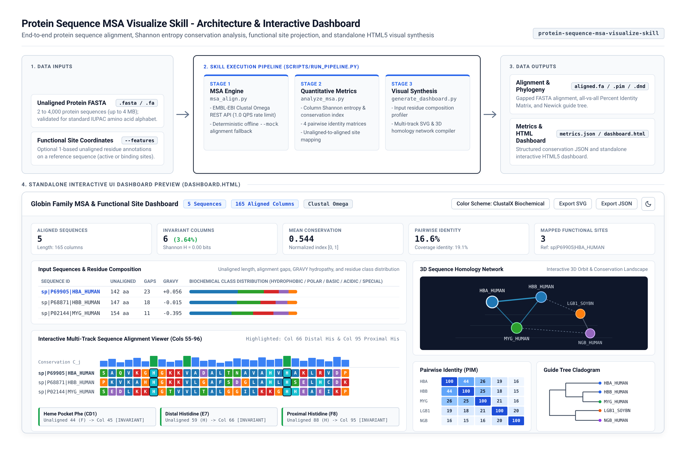

# Protein Sequence MSA Visualize Skill (`protein-sequence-msa-visualize-skill`)

## 1. Overview

`protein-sequence-msa-visualize-skill` is an agent skill for performing protein Multiple Sequence Alignment (MSA), quantitative residue conservation analysis, functional site coordinate projection, and standalone HTML5 visual synthesis.

Building on the EMBL-EBI Clustal Omega Job Dispatcher REST API, this skill addresses a common bottleneck in computational biology workflows: raw flat-text alignments of 10 to 4,000 sequences are difficult to interpret in a terminal or chat window, and manual cross-sequence coordinate comparisons are error-prone.



### Key Capabilities

- **EMBL-EBI Clustal Omega API Integration**: Submits protein FASTA files (2 to 4,000 sequences, up to 4 MB) to Clustal Omega with 1.0 QPS rate limiting, `USER_EMAIL` tracking, and automatic retrieval of aligned FASTA (`fa`), Percent Identity Matrix (`pim`), and Newick guide tree (`phylotree`) endpoints.
- **Quantitative Conservation and Identity Metrics**: Computes column-wise Shannon entropy ($H_j$), normalized conservation indices ($C_j \in [0, 1]$), gap frequencies, consensus sequences, and four sequence identity metrics (Global Identity, Sequence Coverage Identity, Overlap Identity, and Multisequence Conservation Index).
- **Functional Coordinate Projection**: Maps 1-based unaligned functional residue coordinates (such as catalytic triads, heme-binding histidines, or phosphorylation sites) from a reference sequence onto aligned MSA columns and evaluates conservation across homologs.
- **Standalone Interactive HTML Dashboard (`dashboard.html`)**: Compiles input sequence composition profiles, 3D sequence homology networks, biochemical color schemes (ClustalX, Zappo, Taylor, Kyte-Doolittle Hydrophobicity), conservation bar charts, all-vs-all PIM heatmaps, and SVG phylogenetic cladograms into a single HTML5 file that opens directly in any web browser.
- **Deterministic Offline Mock Engine (`--mock`)**: Supports local unit testing, continuous integration, and offline execution without external network access.

---

## 2. Project Structure

All paths are relative to the project root directory:

```text
.
|-- SKILL.md
|-- README.md
|-- LICENSE
|-- SKILL_LICENSES.md
|-- requirements.txt
|-- dashboard.html
|-- .licenses/
|   `-- protein_sequence_msa_visualize_LICENSE.txt
|-- documents/
|   `-- prd.md
|-- assets/
|   |-- color_palettes.json
|   |-- features_schema.json
|   |-- metrics_schema.json
|   `-- skill_overview.png
|-- references/
|   |-- citation.bib
|   |-- color_schemes.md
|   `-- dashboard_schema.md
|-- sample_data/
|   |-- sample_alignment_result.fa
|   |-- sample_globins.fasta
|   |-- sample_phylotree.dnd
|   |-- sample_pim.json
|   `-- sample_ubiquitin.fasta
|-- scripts/
|   |-- __init__.py
|   |-- analyze_msa.py
|   |-- generate_dashboard.py
|   |-- msa_align.py
|   |-- run_pipeline.py
|   |-- visualize_alignment.py
|   `-- visualize_matrix.py
|-- skills/
|   `-- protein_sequence_msa_visualize/
|       |-- SKILL.md
|       |-- LICENSE
|       |-- assets/
|       |-- references/
|       |-- sample_data/
|       `-- scripts/
`-- tests/
    |-- __init__.py
    |-- test_smoke.py
    |-- test_system.py
    `-- test_unit.py
```

---

## 3. Prerequisites and Setup

### System Requirements

- **Operating System**: Linux, macOS, or Windows (WSL2).
- **Python**: Version 3.10 or higher.
- **Browser**: Any modern HTML5-compliant web browser to view `dashboard.html`.

### Python Dependencies

Create and activate a Python virtual environment from the project root directory, then install dependencies from `requirements.txt`:

```bash
python3 -m venv .venv
source .venv/bin/activate
pip install -r requirements.txt
```

### Environment Variables

When executing live queries against the EMBL-EBI Clustal Omega REST API (without `--mock` or `--dry-run`), EMBL-EBI requires a contact email address for job tracking:

```bash
export USER_EMAIL="researcher@example.org"
```

Alternatively, store `USER_EMAIL="researcher@example.org"` inside a `.env` file in the project root directory.

---

## 4. Command-Line Execution

All scripts are executed using relative paths from the project root directory (`scripts/...`) or from the packaged skill directory (`skills/protein_sequence_msa_visualize/scripts/...`).

### 4.1 Unified End-to-End Pipeline

1. **Offline Mock Execution (No Network Required)**:
   ```bash
   python3 scripts/run_pipeline.py sample_data/sample_globins.fasta -o output/mock_globins/ --mock
   ```

2. **End-to-End Pipeline with Functional Feature Projection**:
   ```bash
   python3 scripts/run_pipeline.py sample_data/sample_globins.fasta \
       --features '{"reference_id": "sp|P69905|HBA_HUMAN", "features": [{"name": "Distal Histidine (E7)", "position": 59, "type": "active_site"}, {"name": "Proximal Histidine (F8)", "position": 88, "type": "binding_site"}]}' \
       -o output/globins_annotated/ \
       --mock
   ```

3. **Live EMBL-EBI Clustal Omega Alignment**:
   ```bash
   export USER_EMAIL="researcher@example.org"
   python3 scripts/run_pipeline.py sample_data/sample_ubiquitin.fasta -o output/live_ubiquitin/
   ```

### 4.2 Modular Step-by-Step Execution

```bash
# Step 1: Align sequences
python3 scripts/msa_align.py sample_data/sample_globins.fasta \
    -o output/modular/aligned.fa \
    --output-pim output/modular/matrix.pim \
    --output-tree output/modular/tree.dnd \
    --mock

# Step 2: Calculate Shannon entropy, conservation scores, and 4 identity matrices
python3 scripts/analyze_msa.py \
    --alignment output/modular/aligned.fa \
    --features '{"reference_id": "HBA_HUMAN", "features": [{"name": "Distal His", "position": 59}]}' \
    --output-json output/modular/metrics.json

# Step 3: Compile standalone interactive HTML5 dashboard
python3 scripts/generate_dashboard.py \
    --alignment output/modular/aligned.fa \
    --metrics output/modular/metrics.json \
    --pim output/modular/matrix.pim \
    --tree output/modular/tree.dnd \
    --title "Globin Family MSA" \
    -o output/modular/dashboard.html
```

### 4.3 Running the Test Suite

Run the unit, smoke, and system test suite from the project root directory:

```bash
pytest -v
```

### 4.4 Viewing the Local Test Dashboard (`dashboard.html`)

A pre-generated `dashboard.html` built from `sample_data/sample_globins.fasta` is located at `dashboard.html` in the project root directory and can be opened directly in any web browser.

---

## 5. Non-Technical User Guide

This section explains how researchers, biologists, and other non-technical users can use this skill through an AI assistant without writing code or running terminal commands.

### How It Works

1. **Provide Your Protein Sequences**: Give the assistant a FASTA file path (such as `sample_data/sample_globins.fasta`) or paste two or more protein sequences into the chat.
2. **Ask Your Question in Plain English**: Tell the assistant what you want to compare, such as finding conserved regions, checking how similar two proteins are, or verifying whether an active-site amino acid is preserved across species.
3. **Explore the Interactive Dashboard**: The assistant processes your sequences and opens `dashboard.html` in the preview pane (or saves it to your folder so you can double-click to open it in your browser). Inside the dashboard, you can:
   - Click the Sun/Moon button in the top-right corner to switch between Light and Dark modes.
   - Review the **Input Sequences & Residue Composition** table to compare sequence lengths, gap counts, and amino acid chemistry.
   - Drag and rotate the **3D Sequence Homology Network** to see which proteins cluster together by sequence similarity, or switch to the **3D Conservation Landscape** view.
   - Scroll across the **Multi-Track Sequence Alignment Viewer**, change color palettes, search for short amino acid patterns, and click any column to see its exact breakdown.
   - Inspect the **Pairwise Percent Identity Matrix (PIM)** heatmap and **Phylogenetic Guide Tree** to see evolutionary relationships.

### Real-World Examples for Non-Technical Users

#### Example 1: Comparing Oxygen-Carrying Globin Proteins Across Species

- **What You Want to Know**: You have five oxygen-binding globin proteins from humans and plants (`sample_data/sample_globins.fasta`) and want to know how similar they are overall and which amino acid positions never change during evolution.
- **What You Type**:
  > "Please align the protein sequences in `sample_data/sample_globins.fasta` and create an interactive dashboard so I can compare their percent identity and see the most conserved amino acid positions."
- **What You Receive**:
  - A summary table showing that 5 sequences were aligned across 165 columns, identifying the 6 strictly invariant positions where every species has the exact same amino acid (Columns 1, 16, 39, 45, 66, and 95).
  - The interactive `dashboard.html` visual report where you can click on each protein row or 3D node to inspect its similarity to the others.

#### Example 2: Checking if Heme-Binding Active Sites Are Preserved

- **What You Want to Know**: In Human Hemoglobin subunit alpha (`P69905`), position 44 is a phenylalanine that stabilizes the heme pocket, position 59 is the distal histidine, and position 88 is the proximal histidine that binds iron. Because insertions and deletions shift sequence numbering when proteins are aligned, you want to know where positions 44, 59, and 88 land in the alignment and whether all five proteins keep those exact amino acids.
- **What You Type**:
  > "Align `sample_data/sample_globins.fasta`. Using Human Hemoglobin alpha (`P69905`) as the reference, check whether position 44 (Heme Pocket Phe), position 59 (Distal Histidine), and position 88 (Proximal Histidine) are conserved across all sequences in the alignment."
- **What You Receive**:
  - A direct coordinate translation showing:
    - Unaligned position 44 (`F`) maps to Aligned Column 45 - 100% invariant across all 5 proteins.
    - Unaligned position 59 (`H`) maps to Aligned Column 66 - 100% invariant across all 5 proteins.
    - Unaligned position 88 (`H`) maps to Aligned Column 95 - 100% invariant across all 5 proteins.
  - Interactive feature cards at the bottom of `dashboard.html`; clicking any card automatically scrolls the alignment viewer to that column and highlights it.

#### Example 3: Verifying Sequence Conservation in Highly Conserved Regulatory Proteins

- **What You Want to Know**: You are comparing ubiquitin sequences from human, yeast, plant, and insect species (`sample_data/sample_ubiquitin.fasta`) to check if the attachment site at Lysine-48 (`K48`) is preserved across eukaryotes.
- **What You Type**:
  > "Run an alignment on `sample_data/sample_ubiquitin.fasta`, check position 48 on `UBIQ_HUMAN`, and generate the visual dashboard."
- **What You Receive**:
  - A report confirming over 94% pairwise sequence identity across the eukaryotic ubiquitin family and verifying that Lysine-48 is conserved across all four species, accompanied by the interactive HTML dashboard.
